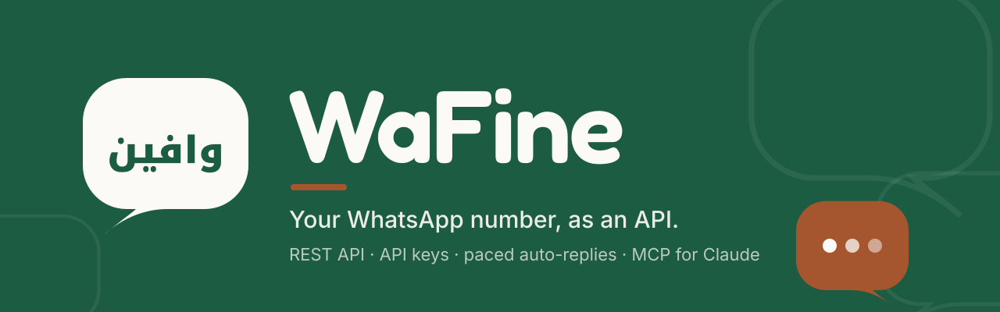

<p align="center">
  
</p>

# WaFine

**Your WhatsApp number, as an API: REST, API keys, paced auto-replies and an MCP endpoint for Claude.**

## What it is

WaFine is an open-core WhatsApp gateway built on [OpenWA](https://github.com/rmyndharis/OpenWA)
(`OpenWA/`, pinned upstream, never edited here). Each user links one number by QR and gets:

- a **REST API** to send and read messages, with an `X-API-Key` header;
- **API keys** scoped to their own session, up to five, revocable from the web app;
- **paced auto-replies** (workflows) that answer allowlisted contacts at a human pace;
- an **MCP endpoint** (`/mcp`) so Claude, or any MCP client, can read chats and send for them;
- a per-session **send budget**, to keep the number clear of ban risk.

This repo holds the product and its infrastructure.

## Architecture

- **Engine:** OpenWA built from source on an OCI Ampere A1 VM (arm64), zero inbound ports.
- **BFF + Valkey** (`app/bff`) beside the engine: auth, API keys, send budget, workflows, MCP and OAuth for Claude connectors.
- **Edge:** Cloudflare Tunnel publishes the BFF; the OpenWA gateway itself stays private on Tailscale.
- **Apps on Vercel:** the web app (`app/web`) and the public docs site (`app/docs`, Fumadocs).
- **Data:** Supabase Postgres (isolated `openwa` schema); media and backups go to Cloudflare R2.

Concrete hostnames, zones and accounts live in the operator vault, not in this repo.

## Docs

- Public docs site (user-facing): [`app/docs`](app/docs/content/docs), starting with the
  [tutorial](app/docs/content/docs/tutorial.mdx). Served at the site root in English, French and Arabic;
  run it with `cd app/docs && bun install && bun run dev`.
- Operator docs: [setup](docs/00-setup.md) · [architecture](docs/02-architecture.md) ·
  [workflows](docs/08-workflows.md) · [sessions, keys and MCP](docs/09-sessions-keys-mcp.md) ·
  [bootstrap](docs/11-bootstrap.md) · [Claude pack](docs/12-claude-pack.md) ·
  [launch checklist](docs/15-launch-checklist.md) · [release process](docs/release.md)
- Working rules for people and agents: [CONTRIBUTING.md](CONTRIBUTING.md).

## Set up with Claude in one prompt

From a fresh clone, paste this into Claude Code:

```text
You are setting up a fresh clone of the WaFine repo for local development. Work only on this machine; deploy nothing.
1. Read README.md and CONTRIBUTING.md first and follow their rules (never edit OpenWA/, never print secrets).
2. Run `git submodule update --init OpenWA`, then `scripts/bootstrap.sh` to install the operator toolchain. If it needs sudo or an interactive login, stop and tell me what to run.
3. Run `make doctor` and report any tool still missing.
4. Run `make check` (shellcheck, tofu fmt, bootstrap tests). Do not fix anything yet; just report failures.
5. Run `make local-up` to build and start the local OpenWA stack on 127.0.0.1, then `make local-ps` to confirm the containers are up.
6. Summarise: what is installed, what passed, the local port, and what still needs my action.
Stop there. Do NOT run `make deploy`, `make deploy-env`, any `make tf-*-apply`/`tf-aws-destroy`, `tofu apply`, `supabase db push` or any DNS change; those need my explicit yes.
```

For agent-driven deploys to a VM or cloud, see `./bootstrap.sh --help` and [docs/11-bootstrap.md](docs/11-bootstrap.md).

## Status (18/10/2026)

Release history: **[CHANGELOG.md](CHANGELOG.md)**.

- [x] OpenWA engine, BFF and Valkey deployed on the VM; gateway and SSH on Tailscale only
- [x] Web app live with invite-only sign-up and an admin allowlist ([docs/08-signup-allowlist.md](docs/08-signup-allowlist.md))
- [x] Public BFF through the Cloudflare Tunnel on the testing playground; the gateway stays private
- [x] Public docs site (`app/docs`)
- [ ] Production launch on the production hosts, 20/10/2026 ([launch checklist](docs/15-launch-checklist.md))
- [ ] Media and backups on Cloudflare R2, EU ([docs/11-media-storage.md](docs/11-media-storage.md))
- [ ] OCI pay-as-you-go decision, after end-to-end tests

## Credits

Project sponsored by Ai4x Academy. Built by ZawIA.Tech. Developed by Mohamed Moughamir (omnizya &
open anaffa), supported by the CDIWG (Bouskoura.online) org. Mentored by Youssef Ghalem (YG
Consulting). Open-core on OpenWA (open source).
