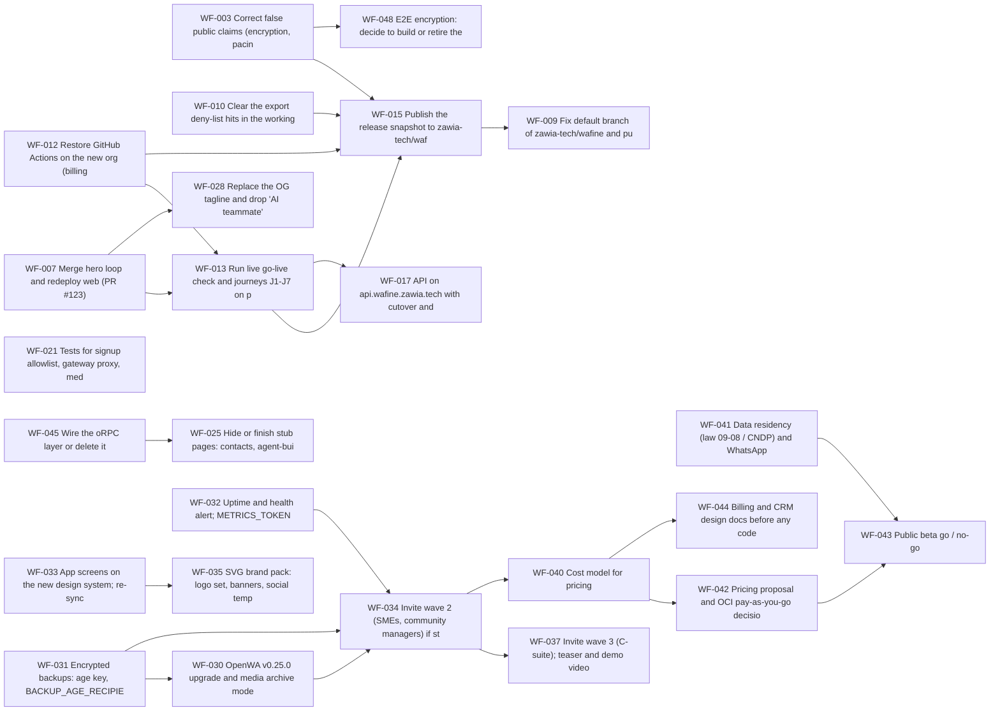

# Roadmap

Public-safe view of the WaFine backlog, generated from the planning board. Security work is tracked privately until fixed. Dates are targets.

## Milestones

| Milestone | Date | Items |
|---|---|---|
| M0 | 2026-10-20 | 11 |
| M1 | 2026-10-25 | 1 |
| M2 | 2026-10-28 | 9 |
| M3 | 2026-10-31 | 3 |
| M4 | 2026-11-02 | 1 |
| M5 | 2026-11-10 | 1 |
| M6 | 2026-11-15 | 1 |
| M7 | 2026-11-17 | 1 |
| M8 | 2026-11-24 | 1 |
| M12 | 2026-12-31 | 7 |

## Dependencies

## Items by milestone

### M0
- `WF-003` P0 `area:docs` Correct false public claims (encryption, pacing, revoke, keys per session)
- `WF-015` P0 `area:ops` Publish the release snapshot to zawia-tech/wafine (export, review, push, tag)
- `WF-007` P1 `area:web` Merge hero loop and redeploy web (PR #123)
- `WF-008` P1 `area:web` Verify blog index after UTC midnight; decide which drafts publish
- `WF-009` P1 `area:ops` Fix default branch of zawia-tech/wafine and push the v0.1.2-alpha tag
- `WF-010` P1 `area:ops` Clear the export deny-list hits in the working repo
- `WF-011` P1 `area:ops` Strip internal-ops passages from draft posts and fix CHANGELOG
- `WF-012` P1 `area:ops` Restore GitHub Actions on the new org (billing) and re-run checks
- `WF-013` P1 `area:ops` Run live go-live check and journeys J1-J7 on production
- `WF-014` P1 `area:ops` Brevo SMTP for Supabase Auth, then mailer_autoconfirm back to false
- `WF-016` P2 `area:ops` Remove the old linked phone device

### M1
- `WF-017` P1 `area:infra` API on api.wafine.zawia.tech with cutover and redirects

### M2
- `WF-021` P1 `area:bff` Tests for signup allowlist, gateway proxy, media presign, MCP client, workflow engine
- `WF-022` P2 `area:web` Add error.tsx, loading.tsx and not-found.tsx boundaries
- `WF-023` P2 `area:web` Fix RTL: replace physical Tailwind classes with logical ones
- `WF-024` P2 `area:web` Translate hardcoded English (admin tabs, contacts, aria-labels, consent page)
- `WF-025` P2 `area:web` Hide or finish stub pages: contacts, agent-builder, mcp-marketplace, Billing and CRM tabs
- `WF-028` P2 `area:brand` Replace the OG tagline and drop 'AI teammate' wording
- `WF-029` P2 `area:docs` Reconcile docs: media store, docs host, Cloudflare, v1.0.0, waasel names
- `WF-038` P2 `area:docs` Native review of Arabic and French copy
- `WF-039` P3 `area:infra` Connect-by-QR: require linked number to equal user_profiles.phone_e164

### M3
- `WF-030` P2 `area:infra` OpenWA v0.25.0 upgrade and media archive mode
- `WF-031` P2 `area:infra` Encrypted backups: age key, BACKUP_AGE_RECIPIENT, first backup and restore test
- `WF-032` P2 `area:ops` Uptime and health alert; METRICS_TOKEN

### M4
- `WF-033` P2 `area:brand` App screens on the new design system; re-sync the design-system artifact

### M5
- `WF-034` P2 `area:growth` Invite wave 2 (SMEs, community managers) if storage math allows

### M6
- `WF-035` P2 `area:brand` SVG brand pack: logo set, banners, social templates, stickers

### M7
- `WF-036` P2 `area:growth` Decide the WaFine-owned domain

### M8
- `WF-037` P2 `area:growth` Invite wave 3 (C-suite); teaser and demo videos

### M12
- `WF-043` P2 `area:growth` Public beta go / no-go
- `WF-044` P3 `area:product` Billing and CRM design docs before any code
- `WF-045` P3 `area:product` Wire the oRPC layer or delete it
- `WF-046` P3 `area:product` Referral program (only a waitlist ref tag exists)
- `WF-048` P3 `area:product` E2E encryption: decide to build or retire the claim
- `WF-049` P3 `area:product` Lean OpenWA fork proposal (core + plugins, multi-tenant)
- `WF-050` P3 `area:product` A2A, in-app assistant, computer-use pairing (Vision items)
